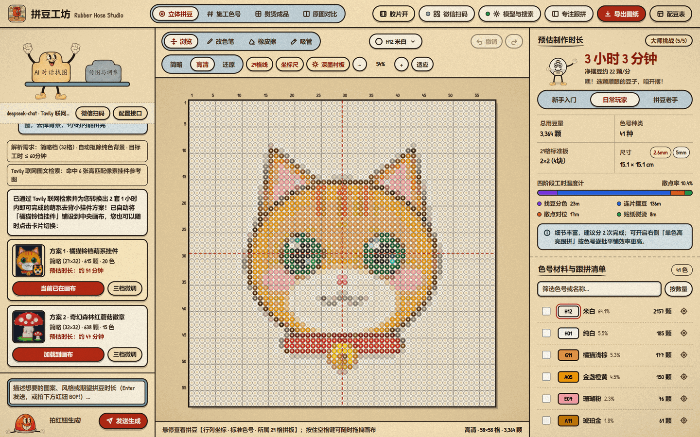
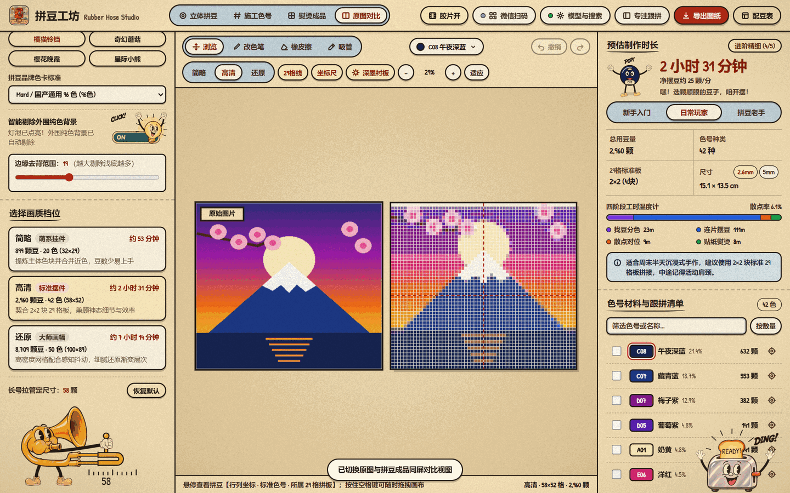
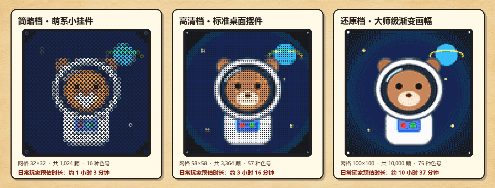
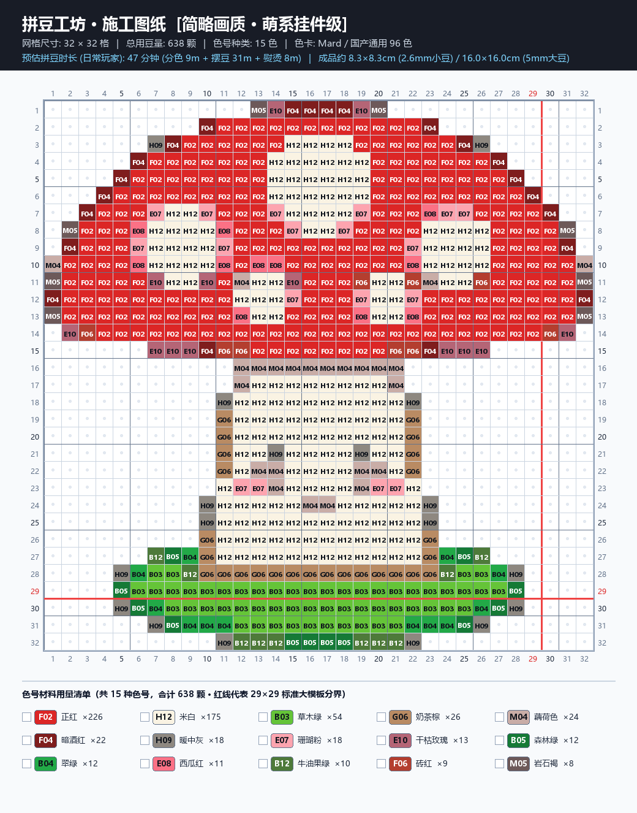

<div align="center">
  

  # 拼豆工坊 · BeadCraft Studio

  **1930s 橡皮管卡通风格 · AI 联网拼豆图纸设计、科学工时测算与微信 ClawBot 远程联动桌面工作台**

  [](#快速开始)
  [](#快速开始)
  [](#2-1930s-rubber-hose-活体卡通控件与同屏对比)
  [](#核心功能详解)
  [](#4-微信-clawbot-扫码对话与高清施工图纸导出)
</div>

---

**拼豆工坊（BeadCraft Studio）** 是一款专为融合豆（Perler / Mard / Artkal 拼豆）手作玩家打造的 Windows 独立桌面应用。它将 **AI 对话搜图推荐（自定义大模型 + Tavily 联网检索）**、**腾讯官方微信 ClawBot 扫码远程传图对话**、**三档内容感知拼豆算法** 与 **1930 年代复古赛璐璐橡皮管卡通交互（Rubber Hose UI）** 融为一体——无论是想找一款 *“1 小时内能拼完的皮卡丘钥匙扣”*，还是把手机相册照片一键转成带真实标准色号的施工图纸，都能在几秒内完成。

---

## 实景效果展示

### 1. 主工作台全景（AI 联网对话推荐 + 赛璐璐拼板 + 专属拼豆小精灵）

在左侧直接用自然语言描述想要的图案与期望拼豆耗时，AI 智能体自动通过 **Tavily** 检索匹配参考图、转换为带真实色号的拼豆候选卡片并铺设上板；右侧橡皮管拼豆小精灵会实时变成当前选中的画笔豆色，同步拆解四阶段制作耗时。



---

### 2. 1930s Rubber Hose 活体卡通控件与原图同屏对比

全界面采用做旧动画赛璐璐画纸与沾水笔浓墨描边设计，深度接入 [`finktheartist/rubber-hose-ui`](https://github.com/finktheartist/rubber-hose-ui) 共享 `24fps` 动画时钟——每一个常用控件都是鲜活会动的卡通角色：踢腿切换的文件夹标签、拉长点亮的小灯泡去背开关（`CLICK!`）、吹奏音符的铜管长号尺寸推杆（`TOOT!`）、巨拳拍扁的红圆顶发送钮（`BOP!`）以及蹦跳弹出吐司片的烤面包机通知员（`DING!`）。



---

### 3. 简略 / 高清 / 还原三档画质与工时实测对比

针对同一张原图自动采用不同的色彩提炼与空间采样策略，同屏直观对比**豆数规模、色号种类与真实制作时长**：



| 画质档位 | 定位场景 | 默认长边 | 算法策略 | 典型豆数 | 日常玩家参考工时 |
| :--- | :--- | :---: | :--- | :---: | :---: |
| **简略（Simple）** | 钥匙扣、小徽章、新手入门 | `32 颗` | 高对比度轮廓提炼 + 近色聚类去噪 | `500 ~ 1,024 颗` | **约 35 ~ 65 分钟** |
| **高清（HD）** | 桌面立牌、标准摆件（`2×2` 块 29 格板） | `58 颗` | 双边保边滤波 + CIELAB 感知映射 | `2,000 ~ 3,364 颗` | **约 2 ~ 3.5 小时** |
| **还原（Faithful）** | 大师级装饰画、人像与晚霞渐变 | `100 颗` | 高密度网格 + 受控 Floyd-Steinberg 误差扩散抖动 | `6,000 ~ 10,000 颗` | **约 6 ~ 11 小时** |

---

### 4. 微信 ClawBot 扫码对话与高清施工图纸导出

支持使用手机微信直接扫描桌面端二维码接入官方 **微信 ClawBot（iLink 通道）**：在手机微信里发文字、发语音或直接发相册照片，电脑主画布会实时同步刷新，并将生成的**带行列坐标尺、`29×29` 分板红线与底部材料核对表的高清施工图纸（PNG）**直接加密发回您的手机微信！

<table>
  <tr>
    <td width="52%" valign="top">
      <p align="center"><strong>手机微信扫码双向联动弹窗</strong></p>
      
    </td>
    <td width="48%" valign="top">
      <p align="center"><strong>实际导出的带色号可打印施工图纸（PNG）</strong></p>
      
    </td>
  </tr>
</table>

---

## 核心功能详解

- **AI 拼豆对话智能体 + Tavily 联网检索**
  - **一句话搜图推荐**：自动识别主题、画质档位、是否抠除背景与工时上限，并发拉取全网参考图转换为多套拼豆方案卡片，支持一键切换上板或进入三档精细微调。
  - **原创矢量插画转拼豆**：当要求“不要搜网图，直接原创画一个像素爱心药水瓶”时，支持大模型直接生成矢量图形并光栅化为三档拼豆图纸。
  - **多服务商自由配置**：内置 **DeepSeek、通义千问（百炼）、硅基流动、Kimi、智谱 GLM、OpenAI 兼容中转、Google Gemini、Anthropic Claude 与本地 Ollama** 预设模板，支持一键测试连通性（密钥仅保存在本机 `.agent_config.json`，已被 `.gitignore` 排除）。
- **腾讯微信 ClawBot 官方协议直连**
  - 完整实现官方 `iLink Bot` 扫码登录状态机、跨区节点重定向、配对码校验与 `AES-128-ECB` 多媒体加解密上传下载；支持微信文字、微信语音转文字与微信原图直转拼豆图纸。
- **真实品牌色卡与智能主体抠背景**
  - 内置 **Mard 国产通用 96 色**、**Perler 经典 58 色**、**Artkal 全彩大师 144 色**，基于 **CIELAB** 均匀感知色空间匹配，并按 WCAG 2.1 相对亮度自动切换黑白高对比度色号文字。
  - 支持**四角连通域洪泛抠背景**：精准剔除外围纯白/纯色背景并自动裁切对焦主体，同时完整保留角色眼白与内部同色高光。
- **四阶段科学工时评估与实操跟拼工具箱**
  - 综合统计**同色横向连排度、换色频率、孤立散点豆比例与跨越 `29×29` 标准大拼板数量**，可视化拆解 **找豆分色 + 连片摆豆 + 散点对位 + 贴美纹纸熨烫** 四阶段耗时（支持 *新手入门 / 日常玩家 / 拼豆老手* 三档速度模型及 `2.6mm mini小豆 / 5.0mm 标准大豆` 成品尺寸换算）。
  - **交互式精修与聚光灯跟拼**：提供 **立体拼豆 / 施工色号 / 熨烫成品 / 原图对比** 四大视图，内置改色笔（可搜索完整色卡）、橡皮擦、吸管、30 步撤销重做、**单色聚光灯高亮定位**、色号完成勾选（进度自动持久化并倒计时剩余分钟数），支持一键导出 **高清 PNG 施工图** 与带底纹的 **Excel 配豆采购清单（`.xlsx`，含 `+5%` 备豆余量）**。

---

## 快速开始

### 环境准备

需安装 **Windows 10 / 11** 与 **Python 3.10+**，在项目根目录安装依赖：

```powershell
pip install -r requirements.txt
```

### 启动方式

- **方式一（推荐 · 原生桌面独立窗口）**：直接双击根目录下的 **`拼豆工坊.exe`**（无命令行黑框，自动唤起独立桌面窗口，关闭窗口后后台服务自动优雅退出）。
- **方式二（脚本 / 命令行启动）**：双击 `启动拼豆工坊.bat`，或在终端执行：
  ```powershell
  python app.py
  ```

---

## 常用快捷键速查

| 快捷键 | 功能说明 |
| :---: | :--- |
| `Space`（按住拖拽） / `H` | 抓手平移画布 |
| `鼠标滚轮` / `+` / `-` | 以鼠标光标为中心无级缩放画布 |
| `0` | 画布一键居中适应窗口 |
| `B` | 切换「改色笔」点涂修改单颗拼豆颜色 |
| `E` | 切换「橡皮擦」擦除单颗拼豆并实时扣减工时 |
| `I` | 切换「吸管」吸取画布上任意拼豆色号 |
| `Ctrl + Z` / `Ctrl + Y` | 撤销 / 重做涂改操作（最高保留 30 步） |
| `Esc` | 退出单色聚光灯高亮跟拼模式 / 关闭色卡浮层 |

---

## 项目结构

```text
beadcraft-studio/
├── 拼豆工坊.exe              # Windows 原生无黑框桌面启动器（内嵌多尺寸橡皮管拼豆图标）
├── app.py                   # 桌面宿主入口、HTTP API 与 SSE 实时会话/微信同步广播服务
├── core/
│   ├── palettes.py          # Mard 96 / Perler 58 / Artkal 144 色卡与 CIELAB 感知匹配
│   ├── generator.py         # 智能四角洪泛抠图与简略/高清/还原三档拼豆矩阵生成引擎
│   ├── estimator.py         # 四维空间拓扑分析与四阶段拼豆制作时长预估模型
│   ├── exporter.py          # 高清可打印 PNG 施工图纸与彩色 Excel 采购清单导出器
│   ├── agent.py             # AI 拼豆 ReAct 对话智能体（搜图推荐 / SVG 原创 / 画板调参）
│   ├── llm_client.py        # OpenAI / Gemini / Anthropic 多协议大模型统一客户端
│   ├── search_client.py     # Tavily 联网图文检索与并发防盗链清洗下载器
│   └── wechat_clawbot.py    # 腾讯官方微信 ClawBot (iLink) 扫码长轮询与 AES-128-ECB 图文收发
├── ui/
│   ├── index.html           # 三栏式复古赛璐璐工作台结构与配置/扫码原生弹窗
│   ├── styles.css           # 1930s Rubber Hose 画纸墨线视觉系统与多分辨率响应式样式
│   ├── main.js              # 高帧率拼豆画布交互、AI 对话、微信同步与老胶片颗粒引擎
│   └── rubber-hose/         # Rubber Hose 活体角色组件库与原创 <hose-bead-mascot> 拼豆小精灵
├── launcher/                # C# Win32 启动器源码与多尺寸 DIB/PNG 桌面图标构建脚本
├── docs/screenshots/        # 实景运行展示图集
└── tests/test_engine.py     # 核心算法、AI 智能体、微信加解密与导出全链路自动化测试
```

---

## 自动化测试

```powershell
python tests/test_engine.py
```

---

## 致谢

- 界面橡皮管卡通交互控件与 `24fps` 手绘四肢物理内核基于开源项目 [**finktheartist/rubber-hose-ui**](https://github.com/finktheartist/rubber-hose-ui)（MIT License）构建与扩展。
